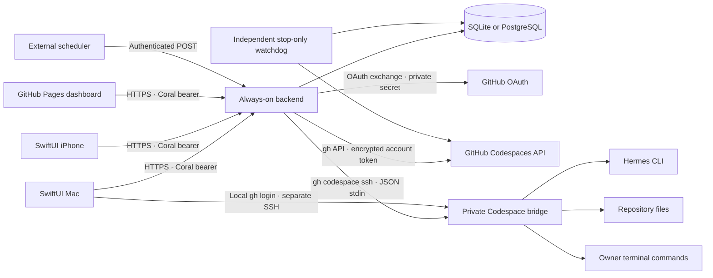

# Coral architecture

## Ownership and authentication

`users` own profiles; profiles retain a GitHub identity, encrypted OAuth token, repository, and Codespace. Every API operation verifies the bearer user owns the selected profile. Bearers are random, hashed in storage, and expire after 30 days. Native clients store their bearer in Keychain. Browser clients use sessionStorage. Logout revokes the presented bearer. OAuth state expires in ten minutes; client-verifier-bound exchange codes expire in one minute and are single-use.

GitHub tokens are encrypted with Fernet and only decrypted inside the backend's GitHub adapter. `gh` receives the token through an environment variable, never a command argument. Profile responses omit privileged fields. The remote bridge has no HTTP listener. Public routes are limited to health, the OAuth flow, and the explicit loopback-only local-development login.

## Sessions and accounting

SQL permits one unfinished session per user. A start reserves the session before requesting VM operations. Duplicate starts reuse that reservation. Sessions contain their start, last accounted timestamp, last meaningful activity, finite extension expiration, and hard allowance deadline.

Elapsed wall time is charged transactionally to account and profile day ledgers, splitting intervals at UTC midnight. Read-only usage requests can account elapsed time without moving the meaningful activity timestamp. Shutdown is only completed in the database after GitHub confirms a terminal state. Failed shutdowns stay `stopping`, keep consuming accounted time, and retry. Thirty seconds are reserved before quota exhaustion for normal shutdown latency.

The normal idle threshold is 600 seconds. Extended mode temporarily changes the idle deadline, never the allowance deadline. Task requests carry a deadline bounded by their configured duration and session allowance. Remote subprocesses independently kill their process groups at that deadline.

## Scheduling

An always-on loop checks persistent `schedules`, external to the clients, GitHub Pages, and the stopped Codespace. SQL occurrence uniqueness and the single active task per profile index protect against duplicate execution. Recurring timestamps advance from the previous scheduled time; missed runs coalesce. One-time schedules pause after dispatch.

Scheduled work only acquires an otherwise idle account. Insufficient allowance records a skipped task and notification. Results and execution failures are stored in `tasks` and `notifications`; clients can retrieve them after the Codespace stops. Completion causes shutdown on the next tick. Graceful exit stops sessions; restart recovery records uncertain in-flight tasks as failures and stops the environment without replay.

`metadata.worker_heartbeat` supports the optional independent systemd watchdog, which stops active Codespaces when the main worker stops reporting. Its credentials remain on the backend host. GitHub's configured native idle timeout is an additional fallback, not a substitute for Coral's authoritative timer.

For Render Free, accounts, tokens, schedules, and accounting live in an external PostgreSQL database. PostgreSQL uses float64 timestamps and row locks for session accounting. A private `POST /internal/tick` hook accepts only the configured scheduler token and wakes supervision without recording user activity. An external cron service calls it independently of the apps. Free mode refuses an ephemeral database fallback. See [RENDER_FREE.md](RENDER_FREE.md) for setup and cold-start limits.

## API outline

| API | Behavior |
| --- | --- |
| `POST /auth/prepare`, `GET /auth/callback`, `POST /auth/exchange` | GitHub authentication / account linking |
| `POST /auth/logout` | Revoke current Coral bearer |
| `GET /profiles` | Profiles without secrets |
| `POST /profiles/{id}/connect`, `/disconnect` | Bind repository/Codespace; initialize bridge/Hermes |
| `POST /profiles/{id}/start`, `/stop`, `/hermes` | Lifecycle controls |
| `GET /profiles/{id}/usage` | Authoritative counters and history |
| `POST /profiles/{id}/activity`, `/extended` | Meaningful activity; finite extension |
| `GET /profiles/{id}/ssh` | Official SSH command/config command, no keys |
| `GET /profiles/{id}/files`, `/file`; `PUT /file` | Workspace browse/read/save |
| `GET/POST /profiles/{id}/tasks` | History / bounded Hermes or terminal task |
| `POST /profiles/{id}/tasks/{task}/cancel` | Cancel owned task |
| `GET /profiles/{id}/tasks/{task}/events` | Bearer-authenticated SSE progress |
| `GET/POST /profiles/{id}/schedules`; `PUT/DELETE /schedules/{schedule}` | Persistent schedule CRUD and pause/resume |
| `GET /notifications`; `POST /notifications/{id}/read` | Persistent result delivery |

Native and web clients use the same contract. Pydantic validates command lengths, names, timestamps, recurrence types, and task/extension durations. Middleware imposes a 2 MB body ceiling and request rate limit; CORS accepts only the configured Pages origin. Responses disable caching and use `nosniff`/`no-referrer`. The Pages CSP forbids external scripts, embedded frames, and objects.

## Scope and operational boundaries

This is a single-worker, personal-workspace implementation with account linking. Horizontal scaling, organization policy management, APNs push delivery while terminated, and distributed scheduler leases are outside the current scope. SQLite storage and encrypted secrets must survive backend restarts. GitHub lifecycle operations and model-provider requests require a working network and the user's billing/permissions setup. An outage of all supervisory services cannot guarantee exact VM billing cutoff; the backend preserves honest usage and retries shutdown.
